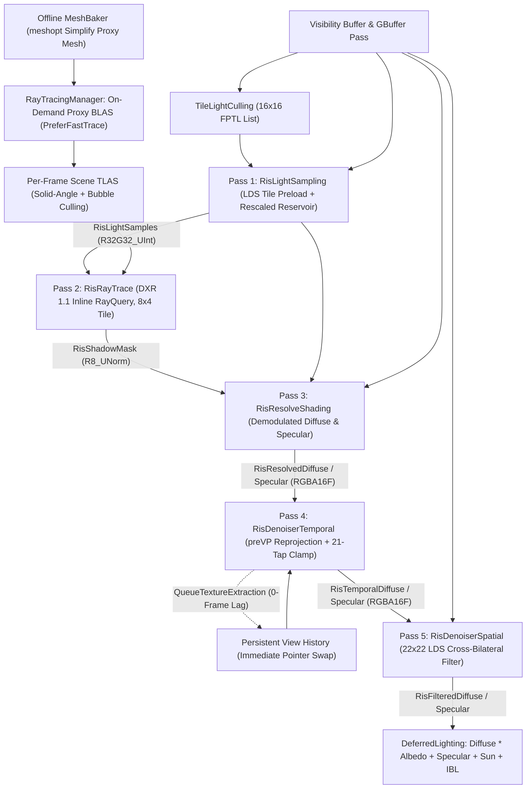

# Stochastic Direct Lighting (RIS), DXR Inline Ray-Traced Shadows & Spatiotemporal Denoising

This document details the architectural design, mathematical foundations, hardware ray-tracing infrastructure, critical debugging root causes, and Nsight Graphics GPU optimizations developed for GhostEngine's **Resampled Importance Sampling (RIS)** direct lighting and soft-shadow pipeline.

---

# 1. Architectural Overview & Motivation

## The Many-Light Shadow Bottleneck
In scenes with dozens or hundreds of shadow-casting punctual lights (point and spot lights), traditional shadow mapping (even with virtualized shadow atlases and GPU-driven meshlet culling) hits two fundamental walls:
1. **Rasterization & Atlas Pressure**: Every point light requires 6 cubemap faces in the shadow atlas, multiplying meshlet culling and rasterization work while exhausting atlas resolution.
2. **Multi-Tap PCF Shading Cost**: Evaluating $N$ overlapping lights per pixel with multi-tap Percentage-Closer Filtering (PCF) scales as $O(\text{Pixels} \times N_{\text{lights}} \times N_{\text{PCF}})$, dropping frame rates to **~70 FPS** in dense multi-light test scenes.

## Decoupled 1-SPP Stochastic Direct Lighting (UE5 MegaLights Style)
Instead of shadowing every light in the tile per pixel, GhostEngine decouples punctual direct lighting into a **1-ray-per-pixel** stochastic pipeline inspired by **Resampled Importance Sampling (Talbot 2005 / Bitterli et al. ReSTIR)** and **Unreal Engine 5 MegaLights**:

1. **Importance Sample** all fine-pruned lights in the $16 \times 16$ FPTL tile using unshadowed BSDF $\times$ radiance luminance, selecting **1 winner light** per pixel.
2. **Trace 1 Hardware Shadow Ray** (DXR 1.1 Inline `RayQuery`) from the surface toward a jittered point on the winner light's spherical area disk.
3. **Evaluate Exact Demodulated Shading** (albedo-free diffuse irradiance + specular radiance) scaled by the unbiased RIS weight $W$.
4. **Reconstruct Clean Convergence** across space and time via a **Temporal Reprojection + Variance-Clamping Denoiser** followed by a **Disocclusion-Adaptive Cross-Bilateral Spatial Filter**, then composite into `Lit_DeferredLighting`.



---

# 2. Hardware Ray-Tracing Infrastructure

## Offline Simplified Ray-Tracing Proxy Meshes (`MeshBaker`)
Building Bottom-Level Acceleration Structures (BLAS) directly from full-resolution Nanite-style LOD0 meshlets (millions of micro-triangles per asset) wastes VRAM, inflates BVH build times, and causes severe ray-traversal divergence.

During asset baking in `MeshBaker.cs`:
1. A coarse **Ray-Tracing Proxy Mesh** is generated via `meshopt_simplify` (targeting a configurable triangle ratio / error budget while locking border vertices as needed).
2. The simplified `float3` vertex stream and `uint32` index buffer are packed directly into the mesh's GPU `MeshBuffer` alongside the meshlet hierarchy (`RayTracingProxyVertexBufferOffset`, `RayTracingProxyIndexBufferOffset`).

## `RayTracingManager`: On-Demand BLAS & Solid-Angle Culled TLAS
`RayTracingManager` (`src/Runtime/Ghost.Engine/RenderPipeline/RayTracingManager.cs`) manages acceleration structures over the bindless D3D12 RHI:

1. **Lazy BLAS Construction (`BuildPendingBlas`)**:
   - When an ECS mesh instance registers via `OnInstanceUpdated`, if its `Mesh` does not yet own a `RayTracingProxyBlas`, it is queued once.
   - Built on the GPU with `AccelerationStructureBuildFlags.PreferFastTrace` and `RaytracingGeometryFlags.Opaque` over a shared, dynamically grown 256-byte-aligned scratch buffer.
2. **Hybrid Per-Frame TLAS Culling (`BuildTLAS`)**:
   - Rebuilt each frame with `PreferFastBuild` from surviving world-space instances using three combined criteria:
     - **Near Bubble** ($d \le 5\,\text{m}$): Always retained so off-screen objects right behind the camera still cast shadows into the view.
     - **Hard Max Distance** ($d \le 300\,\text{m}$): Bounds worst-case open-world scene radius.
     - **Solid-Angle Culling** (no arbitrary mid-range pop-in): Retains an instance of world bounding radius $r$ at camera distance $d$ iff its subtended solid angle exceeds `SolidAngleThreshold`:
       $$\frac{r^2}{d^2} \ge \tau_{\Omega} \quad (\tau_{\Omega} = 0.0005)$$
       Small pebbles cull within meters while large architectural occluders remain in the TLAS across the entire level.
   - The resulting TLAS SRV is exposed globally via `_rayTracingManager.TLASBindlessIndex` in `ResourceDescriptorHeap`.

---

# 3. Decoupled 5-Pass RIS & Spatiotemporal Denoiser

## Pass 1: Candidate Light Importance Sampling (`RisLightSampling.gcomp`)
For each pixel $\mathbf{x}$ with reconstructed camera-relative position $\mathbf{P}_{\text{RWS}}$ and G-Buffer surface $(\mathbf{N}, \mathbf{V}, \alpha, \text{albedo}, \text{metallic})$, we iterate over the $M \le 63$ fine-pruned punctual lights in the pixel's $16 \times 16$ FPTL tile.

### Target PDF ($\hat{p}_k$)
For each candidate light $k$, we evaluate the unshadowed luminance contribution:
$$\hat{p}_k(\mathbf{x}) = \text{Luminance}\Big(\big(f_{\text{Disney}}(\mathbf{V}, \mathbf{L}_k) \cdot \mathbf{w}_{\text{diff}} + f_{\text{GGX}}(\mathbf{V}, \mathbf{L}_k)\big) \cdot (\mathbf{N} \cdot \mathbf{L}_k)^+ \cdot \mathbf{L}_{i,k}\Big)$$
where $\mathbf{w}_{\text{diff}} = \max(\text{albedo} \cdot (1 - \text{metallic}),\, 0.02)$ prevents pure-black or metallic surfaces from completely starving diffuse fill candidates.

### Single-Scalar Rescaled Streaming Reservoir Sampling
Instead of drawing an independent pseudo-random number per light, each pixel initializes **one** spatially and temporally stratified scalar $u \in [0, 1)$ using Interleaved Gradient Noise (IGN) advanced by the golden ratio $\phi^{-1} \approx 0.61803398875$:
$$u_0 = \text{frac}\Big(\text{IGN}(\mathbf{x} + (7.31, 11.79)) + (\text{frameIndex} \bmod 4096) \cdot 0.61803398875\Big)$$
As each candidate light with $\hat{p}_k > 0$ arrives, running weight sum $W_{\text{sum}} \leftarrow W_{\text{prev}} + \hat{p}_k$ updates the reservoir by rescaling $u$ in place:
```hlsl
float prevWeightSum = weightSum;
weightSum += pHat;
float scaledRand = randSample * weightSum;
if (scaledRand >= prevWeightSum)
{
    winnerLightIndex = lightIndex;
    winnerTargetPdf = pHat;
    randSample = (scaledRand - prevWeightSum) / pHat;
}
else
{
    randSample = scaledRand / max(prevWeightSum, 1e-7f);
}
```
This preserves 1D low-discrepancy stratification across the cumulative distribution of all lights in the tile while requiring zero dynamic memory and only **one** floating-point division per candidate.

Finally, the unbiased RIS integration weight is packed alongside `winnerLightIndex` into `R32G32_UInt`:
$$W = \frac{\sum_{k=1}^{M} \hat{p}_k}{\hat{p}_{\text{winner}}}$$

---

## Pass 2: Soft-Shadow Inline Ray Query (`RisRayTrace.gcomp`)
`RisRayTrace` reads `RisLightSamples` and traces **at most 1 shadow ray** per pixel against the scene TLAS:

1. **Coarse-Proxy Position Bias (`ApplyPositionBias`)**:
   Because the BLAS stores a simplified proxy mesh rather than exact displaced/subdivided LOD0 meshlets, grazing rays need a view/light-angle-adaptive normal offset to prevent self-shadowing acne:
   $$b_n = \text{lerp}\big(b_{\max},\, b_{\min},\, \text{saturate}(\mathbf{N} \cdot \mathbf{d}_{\text{ray}})\big), \quad \mathbf{O}_{\text{ray}} = \mathbf{P}_{\text{WS}} + b_n \mathbf{N}$$
2. **Isotropic Soft-Shadow Disk Sampling (`ComputeSoftShadowRay`)**:
   To produce physically plausible contact-hardening penumbrae from spherical light radius $r_{\text{light}} = \text{light.size.x}$:
   - Two **orthogonal** spatial IGN seeds $(u_0, v_0)$ are combined with Martin Roberts' 2D quasi-random $R_2$ sequence $(\alpha_1, \alpha_2) = (0.7548776662, 0.5698402910)$:
     $$\xi = \text{frac}\big((u_0, v_0) + (\text{frameIndex} \bmod 4096) \cdot (\alpha_1, \alpha_2)\big)$$
   - Mapped onto the unit disk via **Shirley–Chiu area-preserving concentric mapping** (`SampleConcentricDisk`), scaled by $r_{\text{light}}$ on the tangent basis $(\mathbf{T}, \mathbf{B})$ perpendicular to the light vector.
3. **Single-Call Hardware Ray Traversal**:
   Compiled with `RAY_FLAG_SKIP_PROCEDURAL_PRIMITIVES | RAY_FLAG_ACCEPT_FIRST_HIT_AND_END_SEARCH | RAY_FLAG_FORCE_OPAQUE | RAY_FLAG_CULL_BACK_FACING_TRIANGLES`, allowing hardware RT cores to resolve occlusion in a single `q.Proceed()` invocation without shader candidate loops.

---

## Pass 3: Albedo-Demodulated Shading (`RisResolveShading.gcomp`)
Keeping shading in its own pass (rather than fusing it into `RisRayTrace`) keeps DXR `RayQuery` state machines out of material shaders and enables future tiled multi-BSDF material classification.

`RisResolveShading` evaluates the winner light multiplied by `shadow * sampleData.weight` and outputs **two separate `R16G16B16A16_Float` targets**:
- **`RisResolvedDiffuse`**: **Albedo-free** diffuse irradiance ($f_{\text{Disney}} \cdot (\mathbf{N} \cdot \mathbf{L})^+ \cdot \mathbf{L}_i \cdot V_{\text{vis}} \cdot W$). Demodulating albedo ensures that spatial filtering blurs noisy lighting across texels without blurring crisp G-Buffer base-color textures; `Lit_DeferredLighting` re-multiplies `risDiffTex * bsdf.diffuseColor` during final composition.
- **`RisResolvedSpecular`**: Specular radiance ($F \cdot D \cdot V_G \cdot (\mathbf{N} \cdot \mathbf{L})^+ \cdot \mathbf{L}_i \cdot V_{\text{vis}} \cdot W$).

---

## Pass 4: Temporal Reprojection & Variance Clamping (`RisDenoiserTemporal.gcomp`)
1. **Neighborhood Moment Estimation in LDS**:
   A $20 \times 20$ tile (for a $16 \times 16$ threadgroup with 2-pixel border) is preloaded into `groupshared` memory. Each pixel computes the first and second moments $(\mu, M_2)$ over a **21-tap ($5 \times 5$ minus corners)** neighborhood:
   $$\sigma = \sqrt{\max(M_2 - \mu^2,\, 0)}$$
   Using 21 taps instead of $3 \times 3$ prevents sparse 1-SPP penumbra misses from collapsing local $\sigma \to 0$ and prematurely rejecting valid history.
2. **Depth-Weighted Reprojection (`preVPMatrix`)**:
   Current camera-relative world position $\mathbf{P}_{\text{RWS}}$ is transformed by `g_ViewData.preVPMatrix` to previous-frame screen coordinates $\mathbf{p}_{\text{prev}}$. Static pixels ($\|\mathbf{p}_{\text{prev}} - \text{round}(\mathbf{p}_{\text{prev}})\|_\infty < 10^{-3}$) take a 1-tap exact fetch; moving pixels evaluate a $2 \times 2$ bilinear filter weighted by relative linear depth similarity ($\Delta z_{\text{rel}} < 4\%$).
3. **Motion-Adaptive Box Clamping & Accumulation Window**:
   Let $m = \|\mathbf{p}_{\text{prev}} - \mathbf{x}\|$ be screen-space motion in pixels and $f_m = \text{saturate}(0.5 m)$:
   - **Static camera ($m \approx 0$)**: Wide clamping box ($\gamma_{\text{diff}} = 3.5$, soft blend `0.12`) and up to **24 diffuse / 16 specular** accumulated frames prevent high-light-count RIS variance from boiling or snapping to black.
   - **Camera motion ($m > 0$)**: Tightens clamping ($\gamma_{\text{diff}} \to 1.75$, $\gamma_{\text{spec}} \to 1.25$) and shortens max frame count (`8` diffuse / `4` specular) to eliminate specular lag and shadow trails.
   - Normalized frame counter `numFrames / 32.0` is stored in `outDiffuse.a`, and current linear `zView` is stored in `outSpecular.a` for the next frame's depth check.

---

## Pass 5: Disocclusion-Adaptive Spatial Filter (`RisDenoiserSpatial.gcomp`)
Reads `RisTemporalDiffuse` / `RisTemporalSpecular` and runs an edge-preserving cross-bilateral filter guided by history confidence `disocclusionFactor`:
$$d_{\text{disocc}} = 1 - \text{saturate}\left(\frac{N_{\text{frames}} - 1}{7}\right)$$

1. **Adaptive Kernel & Firefly Compression**:
   - Newly disoccluded pixels ($d_{\text{disocc}} > 0.05$) run a wide **$7 \times 7$** kernel ($\sigma_{\text{diff}} \le 2.4$) with full Karis HDR tonemap weighting ($\text{strength} = 1.0$) to crush 1-SPP fireflies in a single frame.
   - Converged pixels ($N_{\text{frames}} \ge 8$, $d_{\text{disocc}} = 0$) tighten to a **$5 \times 5$** kernel ($\sigma_{\text{diff}} = 1.1$) and fade Karis compression to `0.1` so steady-state HDR highlights suffer no darkening bias.
2. **Tangent-Plane Depth Stopping**:
   Evaluated in view space so angled floors and curved dragon flanks are never rejected as depth discontinuities:
   $$d_{\text{plane}} = \frac{|\mathbf{N}_{\text{VS}} \cdot (\mathbf{P}_{\text{VS,sample}} - \mathbf{P}_{\text{VS,center}})|}{\max(z_{\text{center}},\, 10^{-3})}, \quad w_z = e^{-100 \, d_{\text{plane}}}$$
3. **Roughness-Driven Normal Stopping**:
   Diffuse uses $(\mathbf{N}_c \cdot \mathbf{N}_s)^4$; specular sharpens normal stopping on mirror surfaces and relaxes it on rough surfaces via $\text{pow}(\mathbf{N}_c \cdot \mathbf{N}_s,\, \text{lerp}(24, 4, \text{saturate}(2r)))$.

---

# 4. Critical Debugging Root Causes & Engineering Lessons

## Lesson 1: The 3-Frame `QueueSwap` Lag ("100x Motion Blur" & Multi-Light Flicker)
### Symptom
Moving the camera produced extreme ghosting trails resembling 100x motion blur, and static surfaces lit by many lights flickered with a 3-frame beat pattern.

### Root Cause
`RenderGraph.CompileAndExecute` extracted `RisTemporalDiffuse` into persistent `viewContext.RisHistoryDiffuse` by calling `ResourceDatabase.QueueSwap(actualHandle, target)`.
In GhostEngine's D3D12 RHI, `QueueSwap` was originally built for async streaming buffer growth: it **queues** the swap into a deferred queue that waits `FRAMES_IN_FLIGHT` (3 frames!) so existing bindless indices stay stable for in-flight command lists, while swapping the underlying `ID3D12Resource` pointers later.
As a result:
- Frame $t$ did **not** read history from frame $t - 1$; it read stale history from frame $t - 3$!
- Temporal accumulation split into **three independent non-communicating frame chains** ($t \bmod 3$), tripling convergence lag and causing 3-frame oscillation and severe reprojection mismatch under camera motion.

### Fix
Added `bool preserveBindlessIndex = true` (default `true` for backward safety across streaming callers) to `IResourceDatabase.Swap`:
- When `preserveBindlessIndex: false` (used by `RenderGraph` texture extraction, where passes resolve fresh bindless indices every frame via `GetActualBindlessIndex`), `D3D12ResourceDatabase.Swap` **immediately** swaps both the `ResourceRecord` and `ResourceViewGroup` in $O(1)$ on the CPU timeline, and `RenderGraphResourcePool.RestoreBackingResources` synchronizes initial/current D3D12 barrier states across the swapped handles.
- Also threaded `ulong frameNumber` (`_submittedFrame`) into `IRenderPipeline.ExecuteGraph` so temporal RNG sequences advance monotonically once per rendered frame.

---

## Lesson 2: 6-Band Soft-Shadow Stepping from Linearly Correlated IGN
### Symptom
Close inspection of soft shadow penumbrae revealed ~6 distinct stepped shadow silhouettes fanned along a single diagonal direction instead of a smooth isotropic penumbra.

### Root Cause
1. **Linear Correlation Inside IGN**: Interleaved Gradient Noise is $\text{frac}(52.9829189 \cdot \text{frac}(0.06711056 x + 0.00583715 y))$. Generating a 2D sample by shifting pixel coordinates with constant offsets `(pixel + (17, 59))` adds a **constant** inside the linear dot product before `frac()`, making the second coordinate a deterministic piecewise-linear function of the first! Combined with polar mapping $(r = \sqrt{u_1}, \theta = 2\pi u_2)$, 2D disk samples collapsed onto 1D curves.
2. **Quasi-Periodic Frame Multiplier**: `IGN(pixel, frame)` advanced frame index by `5.588238f` ($\text{frac} \approx 0.588 \approx 3/5.1$), causing the temporal offset to nearly repeat every ~5–6 frames inside a short EMA window.

### Fix
1. Replaced the second spatial seed with a **90°-rotated orthogonal coordinate** `(y + 19.19, -x + 47.73)` so $\nabla u_0 \perp \nabla v_0$ across screen space.
2. Replaced 1D frame stepping with the **2D $R_2$ low-discrepancy sequence** $(0.7548776662, 0.5698402910)$ and **Shirley–Chiu concentric disk mapping**, preserving 2D stratification isotropically in all directions.

---

# 5. Nsight Graphics Profiling & GPU Optimizations (`3.95 ms -> 2.25 ms`)

Profiling all 5 passes with Nsight Graphics PC-Sampling revealed that **73%** of total RIS GPU time sat in `RisLightSampling` (`1.50 ms`) and `RisDenoiserSpatial` (`1.29 ms`), dominated by `Long Scoreboard` (redundant global buffer/texture reads), `MIO Throttle` (SFU transcendental & 3-DWORD LDS stalls), and `[unroll]` instruction cache/VGPR bloat.

## Optimization Breakdown by Pass

1. **`RisLightSampling.gcomp` (`1.50 ms` baseline)**
   - **Cooperative LDS Light Preload**: Since `[numthreads(16, 16, 1)]` maps 1:1 to FPTL's $16 \times 16$ tiles, threads `0..lightCount-1` preload `GPUPunctualLight`, pre-transform `positionWS -> positionRWS`, pre-multiply `color * lightDimmer`, and store a compact 64-byte `SharedCandidateLight` into `groupshared s_lights[64]` in parallel with `depthTexture` fetches. Eliminated up to $256 \times 63 \times 11$ redundant `rawBufferLoad`s per tile.
   - **Pre-`rsqrt` Culling**: Tested `distSq * invRangeSq >= 1.0f || dot(normalWS, unL) <= 0.0f` **before** `rsqrt(distSq)`, skipping SFU ops and spot/BSDF math on out-of-range lights.
   - **Hoisted BSDF Invariants**: Hoisted `baseRoughness`, `GetSmithJointGGXPartLambdaV`, and Disney diffuse $(1 - \mathbf{N}\cdot\mathbf{V})^5$ outside the candidate loop.

2. **`RisDenoiserSpatial.gcomp` (`1.29 ms` baseline, `6,425` DXIL instructions, `60` VGPRs)**
   - **Cooperative $22 \times 22$ LDS Tile**: Preloaded linear `s_zView` (`float`) plus lossless 64-bit `uint2` FP16 `s_normalRough`, `s_diffuse`, and `s_specular` (skipping sky texels during preload). Reduced global texture fetches and `OctahedralDecode` calls from **49 per pixel to 1.89 per thread** (~25x reduction).
   - **4-FMA View-Space Tangent Plane**: Rotated `centerNormal` into view space once (`TransformWorldToView`); since $\mathbf{P}_{\text{VS}} = (r_x z, r_y z, z)$, evaluating $\mathbf{N}_{\text{VS}} \cdot \mathbf{P}_{\text{VS,sample}} - d_0$ inside the loop costs **4 FMAs** instead of 49 world-space matrix reconstructions and projection divisions.
   - **Separable 1D Gaussian + `[loop]` Adaptive Radius**: Precomputed 1D Gaussian weights $g_1, g_2, g_3$ outside the loop (eliminating 98 `exp()` SFU calls per pixel), switched `exp`/`pow` to `exp2` with flat-surface fast paths, removed `[unroll]`, and narrowed converged pixels ($N_{\text{frames}} \ge 8$) from $7 \times 7$ (49 taps) to $5 \times 5$ (25 taps).

3. **`RisRayTrace.gcomp` & `ScreenSpaceTracing.hlsl` (`0.60 ms` baseline)**
   - Removed dead `while (q.Proceed())` non-opaque candidate state-machine branching (redundant under `RAY_FLAG_FORCE_OPAQUE`).
   - Switched threadgroup size from `16x16` to **`[numthreads(8, 4, 1)]`** (1 single 32-thread warp per $8 \times 4$ screen tile for tighter ray/BVH coherence) and overlapped `depth` + `risLightSamples` and `gb1` + `GPUPunctualLight` L2 fetches.

4. **`RisResolveShading.gcomp` (`0.14 ms` baseline)**
   - Loaded `risShadowMask` and `risLightSamples` **first**, early-outing on sky, unlit, and occluded (`shadow <= 0`) pixels before issuing any `depth`, `gb0`, `gb1`, or `GPUPunctualLight` reads.

5. **`RisDenoiserTemporal.gcomp` (`0.30 ms` baseline, `56` VGPRs)**
   - Replaced `groupshared float3` arrays (which lacked native 96-bit `LDS.96` hardware loads and caused `6,038` `MIO Throttle` samples) with 64-bit aligned `uint2` FP16 arrays (`LDS.64`, lossless on `RGBA16F` inputs, cutting LDS footprint from `9.6 KB` to `6.25 KB`).
   - Added a 1-tap integer fast path for static-camera pixels and `[loop]` for 4-tap subpixel motion to lower VGPR pressure.

## Performance Results
| Configuration / Metric | GPU Cost / Frame Rate |
| :--- | :--- |
| **Shadow Atlas + PCF Baseline** | **~70 FPS** |
| **Decoupled RIS + DXR Soft Shadows (Unoptimized)** | **3.95 ms** RIS total (~170 FPS) |
| **Decoupled RIS + DXR Soft Shadows (Optimized)** | **2.25 ms** RIS total (**-1.70 ms / ~43% faster**) |

---

# 6. Future Roadmap

1. **Tiled Multi-BSDF Material Classification in `RisResolveShading`**:
   - Promote `RisResolveShading` to a Ghost.DSL template (`Lit_RisResolveShading.template.hlsl`) using `tileShadingModelMaskBuffer` and `DEFERREDLIGHTING_STRATEGY` (matching `Lit_DeferredLighting.template.hlsl`), allowing custom shading models (Anisotropic, Subsurface, ClearCoat, Cloth, Toon) to evaluate exact demodulated BSDFs while keeping `RisRayTrace` material-agnostic.
   - For two-sided / subsurface transmission models where $\mathbf{N} \cdot \mathbf{L} < 0$ contributes energy, inspect `shadingModel` from `GBuffer2.g` in `RisLightSampling` so back-facing lights receive non-zero $\hat{p}_k$.
2. **History-Guided Visibility Feedback (`RisVisibleLightHash`)**:
   - Record per-tile / spatial-hash light visibility from `RisRayTrace` and down-weight persistently occluded lights behind walls during `RisLightSampling` candidate selection so rays are concentrated on actually visible lights.
3. **Alpha-Masked Foliage Shadows**:
   - Split alpha-tested geometry into a secondary `NonOpaque` BLAS geometry flag (or Opacity Micromaps) while keeping opaque scene meshes on the fast single-call `RAY_FLAG_FORCE_OPAQUE` path.
