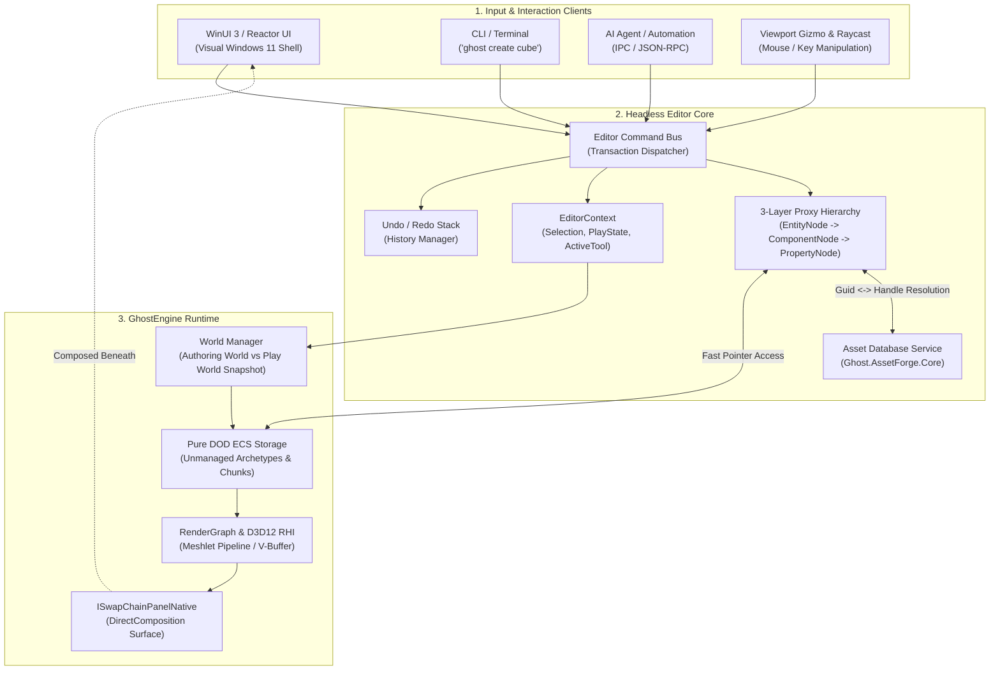
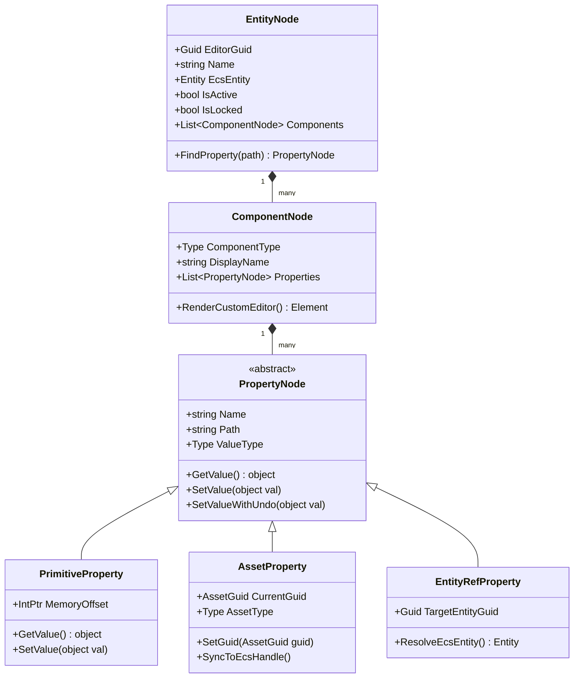
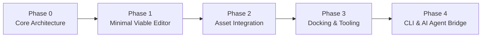

# GhostEngine — Editor Architecture, Feature Specification & Master Roadmap

## 1. Executive Summary & Vision

GhostEngine's editor (**GhostStudio**) is an extensible, modular, high-performance, and **AI/CLI-first (2026+)** scene authoring and tooling environment.

Rather than treating the editor as a monolithic GUI app wrapped around an engine, GhostStudio is designed around a **"Headless-First"** architectural principle:
* **The Editor Core is completely decoupled from the UI.** Every single action (entity creation, property editing, asset assignment, scene transitions) is represented as a formal, serializable **Command**.
* **Dual-World ECS & Scene as Asset:** The authored scene is treated as an authoring document, while the runtime ECS is a lean, unmanaged, downstream consumer. No editor metadata ever pollutes runtime ECS archetypes, ensuring clean Play/Stop cycles with zero stripping overhead.
* **3-Layer Proxy Hierarchy (`EntityNode` $\to$ `ComponentNode` $\to$ `PropertyNode`):** Eliminates double-buffering for raw numeric data by reading/writing directly to ECS memory, while providing a dedicated home for authoring metadata, persistent `AssetGuid`s, and stable entity references.
* **Modern Windows 11 Fluent UI via Declarative C# (Reactor) + D3D12 `SwapChainPanel`:** DirectComposition enables high-fidelity native UI overlays directly on top of the DirectX 12 viewport with zero airspace clipping, combined with the ergonomic, functional simplicity of declarative C# components.
* **First-Class AI & Automation (2026+):** All editor operations are exposed via a structured Command Bus and local IPC/CLI interface, allowing external AI coding agents, automation scripts, and CI runners to inspect, mutate, and build scenes identically to a human developer.

---

## 2. High-Level Architecture Topology



---

## 3. Visual Layout & Workspace Organization

GhostStudio is organized around a customizable, docked multi-panel workspace utilizing Windows 11 Fluent Design (Mica backdrops, acrylic surfaces, and 4px typography grid):

```
┌─────────────────────────────────────────────────────────────────────────────────────────────────┐
│ [GhostStudio]  File   Edit   Assets   GameObject   Component   Window   Help       [Play] [Pause]│
├───────────────────┬─────────────────────────────────────────────────┬───────────────────────────┤
│ Scene Hierarchy   │ 3D Scene Viewport (D3D12 SwapChainPanel)        │ Inspector                 │
│ ───────────────── │ ─────────────────────────────────────────────── │ ───────────────────────── │
│ 🔍 Search Entity  │ [Gizmo: Trans|Rot|Scale] [Coords: World|Local]  │ 📦 Player (EntityNode)    │
│                   │                                                 │ GUID: 550e8400-e29b...    │
│ ▼ Scene: Root     │                                                 │ Static: [ ] Active: [x]   │
│   ► DirectionalLt │                                                 │                           │
│   ▼ Environment   │                  [ 3D Scene ]                   │ ▼ Transform               │
│       GroundPlane │                                                 │   Position: [0, 0, 0]     │
│     ► Foliage     │                                                 │   Rotation: [0, 0, 0]     │
│   ▼ Characters    │                                                 │   Scale:    [1, 1, 1]     │
│     ► Player (S)  │                                                 │                           │
│     ► Enemy_01    │                                                 │ ▼ MeshRenderer            │
│                   │                                                 │   Mesh:   [CubeMesh.fbx ] │
│                   │                                                 │   Mat:    [DefaultLit.mat]│
│                   ├─────────────────────────────────────────────────┤   CastShadows: [x]        │
│                   │ View Modes: [Lit ▼] [Stats: 144 FPS | 4.2ms]   │                           │
├───────────────────┴───────────────────────┬─────────────────────────┴───────────────────────────┤
│ Content Browser                           │ Console & Terminal Output                           │
│ ───────────────────────────────────────── │ ─────────────────────────────────────────────────── │
│ 📁 Assets                                 │ [Info] AssetForge: Baked 14 meshlet clusters (12ms) │
│   ├── Models                              │ [Warn] Light 'PointLight' has no shadow map assigned│
│   ├── Shaders                             │ [Error] NullReference in Script 'CameraController'  │
│   └── Textures                            │ ─────────────────────────────────────────────────── │
│ [ 📦 Hero_Mesh ] [ 🎨 Hero_Albedo ]       │ > ghost set-property Player Transform.Position 0 5 0│
└───────────────────────────────────────────┴─────────────────────────────────────────────────────┘
```

---

## 4. Core Subsystem Specifications

### Subsystem 1: Editor Core & Command Infrastructure

The Editor Core contains zero UI code. All modifications funnel through an atomic Command pattern.

* **Command Interface (`IEditorCommand`):**
  * `Name`: Human-readable description (for UI Undo/Redo menus).
  * `Execute(EditorContext)`: Mutates proxy and ECS state.
  * `Undo(EditorContext)`: Exact inverse mutation.
  * `MergeWith(IEditorCommand)`: Groups continuous high-frequency updates (e.g. mouse drag on a slider or 3D gizmo) into a single undo step.
* **Undo / Redo Stack:**
  * Configurable depth (default 100 actions).
  * Transaction scopes for complex multi-entity edits (e.g., duplicate hierarchy, delete multiple assets).
* **`EditorContext` (Ambient State Service):**
  * **Selection Model:** Active selected entity GUIDs, selected asset GUIDs.
  * **Play State:** `EditMode`, `PlayMode`, `Paused`, `SingleStep`.
  * **Active Tool:** Current viewport manipulation tool (`Translate`, `Rotate`, `Scale`, `Bounds`, `TerrainBrush`).
  * **Coordinate Space:** `World` vs `Local`, snap settings (grid, angles).

---

### Subsystem 2: 3-Layer Proxy Hierarchy (`EntityNode` $\to$ `ComponentNode` $\to$ `PropertyNode`)

Provides an extensible, high-performance bridge between raw unmanaged ECS chunks and authoring workflows.



* **`EntityNode`:**
  * Owns the persistent 128-bit `EditorGuid`. Entity references across scenes, prefabs, and undo stacks use this GUID rather than the volatile ECS entity handle.
  * Maintains parent-child tree hierarchy without polluting the runtime ECS with parent pointers unless explicit runtime hierarchy components are requested.
* **`ComponentNode`:**
  * Stores metadata about the component type (category, icon, description, documentation link).
  * Automatically inspects component fields via reflection or Roslyn source-gen metadata (`ComponentMeta<T>`).
  * Supports custom editor overrides (`[CustomEditor(typeof(MyComponent))]`).
* **`PropertyNode` Polymorphism:**
  * **`PrimitiveProperty<T>`:** Zero-allocation adapter. Accesses ECS chunk memory directly via pointer offsets.
  * **`AssetProperty`:** Stores authoring `AssetGuid`. Whenever the GUID changes, it queries `Ghost.AssetForge.Core` to load/fetch the runtime `Handle<T>`, writing the handle into the ECS chunk.
  * **`EntityRefProperty`:** Stores target `EntityNode.EditorGuid`. Immune to entity re-indexing bugs during undo/redo or prefab instantiation.
  * **`EnumProperty` / `FlagsProperty`:** Displays clean dropdowns or multi-select bitmask pills.

---

### Subsystem 3: Scene Lifecycle & Dual-World Execution

Separates authoring persistence from runtime execution.

* **Scene File Format (`.ghostscene`):**
  * Human-readable, git-merge-friendly text serialization (JSON or YAML) storing `EntityNode`s, component names, and `PropertyNode` values.
  * Never serializes volatile memory addresses, raw pointers, or ephemeral `Handle<T>` values.
* **Play / Edit Lifecycle:**
  * **Edit Mode:** Viewport renders the authored world. Physics and gameplay systems remain stopped; editor-specific systems (camera controller, gizmo tracking, asset live reload) run.
  * **Entering Play Mode:**
    1. The unmanaged ECS memory chunks are snapshotted in-memory via block memory copy (`< 1ms`).
    2. The simulation starts: physics, scripts, animations, and game systems tick.
    3. The editor proxy tree remains detached and safe from corruptive gameplay mutations.
  * **Exiting Play Mode:**
    1. The dirty runtime ECS world is discarded.
    2. The pre-play snapshot is restored into the ECS memory buffer.
    3. `EntityNode.EcsEntity` handles re-link seamlessly. Zero stripping passes required.
* **Asset Baking Integration:**
  * At game export time, `Ghost.AssetForge.CLI` processes `.ghostscene` files into optimized binary chunk streams with pre-resolved handles, ready for direct consumption by `TestGame` under NativeAOT.

---

### Subsystem 4: 3D Viewport & Manipulation Tools

* **D3D12 Presentation via `SwapChainPanel`:**
  * Utilizes `ISwapChainPanelNative::SetSwapChain` for direct DXGI swapchain composition.
  * Zero airspace issues: XAML / Reactor UI overlays (view cubes, gizmo toolbars, statistics HUDs) blend seamlessly over the 3D render surface.
* **Camera Controllers:**
  * **Fly-Camera:** Right-click + WASD + QE with mouse look and scroll-wheel speed adjustment.
  * **Orbit / Arcball:** Alt + Left Click to orbit around selection; Alt + Right Click to dolly.
  * **Focus Frame (`F`):** Instantly frames camera onto bounding sphere of selected `EntityNode`.
  * **Orthographic Views:** Top, Bottom, Front, Back, Left, Right with smooth projection toggling.
* **Transform Manipulation Gizmos:**
  * **Translation:** Axis arrows + planar quads (XY, XZ, YZ) + screen-space view plane handle.
  * **Rotation:** Euler axis rings + screen-space trackball outer ring.
  * **Scale:** Axis boxes + uniform center box.
  * **Snapping:** Grid snapping (e.g. 0.25m, 1m) and angular snapping (e.g. 15°, 45°).
* **GPU-Accelerated Object Picking:**
  * In addition to CPU raycasting against bounding boxes, the engine uses a **Hardware Picking Pass** leveraging the Visibility Buffer / Object ID render target. Reads back pixel coordinates under the cursor for pixel-perfect triangle selection.
* **Viewport Visualization Modes:**
  * **Lit (PBR):** Final shaded scene.
  * **Wireframe:** Overlay on top of shaded geometry.
  * **Meshlet Clusters:** Visualizes individual meshlet clusters with random pseudocolors.
  * **Overdraw Heatmap:** Debugs quad and triangle raster density.
  * **LOD Coloration:** Visualizes current cluster LOD levels.
  * **Editor Overlays:** Grid floor, light icons, camera frustums, collision wireframes, navigation meshes.

---

### Subsystem 5: Content Browser & Asset Pipeline Integration

Front-end UI over `Ghost.AssetForge.Core`.

* **Asset Database & Virtual File System:**
  * Bi-directional monitoring of the `Assets/` directory via `FileSystemWatcher`.
  * Automated `.meta` generation with immutable UUIDs for every source file.
* **Visual Content Browser:**
  * Folder tree hierarchy + multi-column grid of asset cards.
  * Real-time thumbnail generator for 3D meshes, textures, materials, and audio files.
  * Search bar with tag filters (`t:mesh`, `t:texture`, `t:shader`).
* **Drag-and-Drop Workflows:**
  * Dragging a Mesh asset from Content Browser $\to$ Viewport instantiates a new `EntityNode` with a `MeshRendererComponent`.
  * Dragging a Material asset onto an entity in the Viewport or Inspector updates the corresponding `AssetProperty`.
* **Hot Reloading:**
  * Shader DSL (`Ghost.DSL`) changes recompile immediately and hot-patch D3D12 pipeline state objects.
  * Texture and mesh changes re-bake in the background and update the loaded runtime `Handle<T>` without restarting the editor.

---

### Subsystem 6: CLI & AI-First Extensibility (2026+ Ready)

Enables full automation by external AI agents, scripts, and CI/CD pipelines.

* **Local IPC / JSON-RPC Server:**
  * The editor spins up a lightweight local Named Pipe or localhost WebSocket server.
  * Accepts structured JSON-RPC requests conforming to the Command Bus.
* **Self-Describing Schema Export:**
  * `ghost schema export`: Generates `editor_schema.json` documenting every registered component, property, field type, and available editor command.
  * AI coding assistants can ingest this schema to generate syntactically correct scene modifications.
* **Headless CLI Verbs (`Ghost.AssetForge.CLI` / `ghost`):**
  ```bash
  # Querying
  ghost scene query --component MeshRenderer
  ghost scene inspect --entity 550e8400-e29b-41d4-a716-446655440000

  # Manipulation
  ghost entity create --name "EnemySpawner" --parent "Enemies"
  ghost property set --entity "EnemySpawner" --path "Transform.Position" --value "10,0,5"
  ghost asset assign --entity "EnemySpawner" --property "MeshRenderer.Mesh" --guid "a1b2c3d4..."

  # Build & Verification
  ghost scene validate --scene "Scenes/Level01.ghostscene"
  ghost build publish --platform win-x64 --config Release
  ```
* **Integrated Editor Terminal / Command Palette (`Ctrl+P` / `Ctrl+Shift+P`):**
  * Instant search across all commands, assets, entities, and settings.
  * Interactive REPL console for running CLI commands directly inside the editor shell.

---

### Subsystem 7: Windowing & Docking Architecture

* **Declarative C# Docking Tree:**
  * Replaces rigid XAML templates with a recursive data-driven dock tree (`SplitNode`, `TabNode`, `DocumentNode`).
  * Docking layout can be serialized to and restored from `workspace_layout.json`.
* **Docking Capabilities:**
  * Docking to window edges (Left, Right, Top, Bottom) with live visual drop previews.
  * Tab grouping and tab tearing.
  * Floating windows (tearing out a panel into an independent OS window).
* **High-DPI & Multi-Monitor Support:**
  * Per-monitor DPI scaling managed smoothly via Windows App SDK / WinUI 3.

---

## 5. Master Roadmap & Implementation Phases



### Phase 0: Core Architecture & Foundations
- [ ] Define `IEditorCommand`, `CommandBus`, and `UndoStack`.
- [ ] Implement `EditorContext` (Selection, PlayState, ActiveTool).
- [ ] Implement the 3-Layer Proxy Hierarchy (`EntityNode`, `ComponentNode`, `PropertyNode`).
- [ ] Implement `PrimitiveProperty<T>` reading/writing directly to unmanaged ECS memory.
- [ ] Implement `AssetProperty` bridging `AssetGuid` $\leftrightarrow$ `Handle<T>`.
- [ ] Verify D3D12 `SwapChainPanel` DirectComposition interop in a clean test harness.

### Phase 1: Minimal Viable Editor (MVE — Scene Authoring)
- [ ] Implement basic Scene Viewport using `SwapChainPanel` with Flycam controls.
- [ ] Implement Scene Hierarchy panel showing `EntityNode` tree.
- [ ] Implement reflection-based Component Inspector using Reactor declarative components.
- [ ] Implement 3D Translation, Rotation, and Scale gizmos in the viewport.
- [ ] Implement `.ghostscene` serialization and deserialization (Save / Load).
- [ ] Implement Play / Stop ECS world snapshotting (in-memory block copy).

### Phase 2: Asset Workflow & Content Integration
- [ ] Connect `Ghost.AssetForge.Core` to the editor's Virtual File System.
- [ ] Implement Content Browser panel with folder tree and asset item cards.
- [ ] Implement Drag-and-Drop from Content Browser into Inspector asset slots and Viewport.
- [ ] Add live hot-reload for shaders and textures during edit mode.
- [ ] Add basic Asset Metadata Inspector (mesh import settings, texture compression settings).

### Phase 3: Docking, Polish & Visual Diagnostics
- [ ] Implement declarative C# Docking container (split panes, tabs, persistent layouts).
- [ ] Implement Hardware GPU ID Picking (pixel-perfect selection in viewport).
- [ ] Add Viewport Debug Modes (Wireframe, Meshlet Clusters, Overdraw Heatmap).
- [ ] Implement Undo / Redo History view panel.
- [ ] Implement rich Console panel with log filtering and source link navigation.

### Phase 4: CLI, Automation & AI Agent Integration (2026+)
- [ ] Implement local Named Pipe / JSON-RPC server routing to the `CommandBus`.
- [ ] Build the standalone `ghost` CLI tool wrapping the IPC protocol.
- [ ] Implement `ghost schema export` for machine-readable editor API self-description.
- [ ] Add Command Palette (`Ctrl+Shift+P`) inside the editor shell.
- [ ] Validate automated end-to-end scene generation using an external AI coding agent.

---

## 6. Summary Comparison: Traditional vs. GhostStudio Architecture

| Dimension | Traditional Game Engine Editor | GhostStudio (GhostEngine) |
| :--- | :--- | :--- |
| **UI Paradigm** | Heavy OOP MVVM or bloated XML | Declarative C# (`Microsoft.UI.Reactor`) over WinUI 3 |
| **ECS Coupling** | Tightly couples editor metadata to runtime entities | Strict isolation via 3-Layer Proxy; ECS remains pure unmanaged DOD |
| **Viewport Interop** | Child HWND hole punching (airspace issues) | Native DirectComposition (`SwapChainPanel`), zero airspace conflict |
| **Asset References** | Volatile pointers or string paths | Stable 128-bit `AssetGuid` resolved to transient `Handle<T>` |
| **Play/Stop Transition** | Slow reflection query & component stripping | Instant ECS memory snapshot blit; zero stripping |
| **Tooling & AI** | GUI-only; impossible to automate | Headless Command Bus with native CLI and JSON-RPC IPC |
